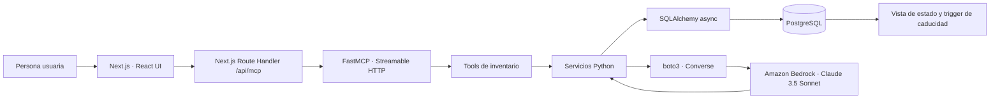

# Despensa Viva

Inventario de cocina zero-waste con un frontend React/Next.js, un servidor MCP por Streamable HTTP y extracción de productos de recibos con Amazon Bedrock.

Despensa Viva conecta eventos cotidianos (comprar, abrir, mover o consumir un alimento) con un inventario cuyo semáforo usa las fechas calculadas por PostgreSQL. El frontend mantiene un modo demo interactivo cuando el backend no está disponible.

## Qué incluye

- **Interfaz de cocina responsive** con simulador de eventos, filtros, búsqueda y estados legibles por color y etiqueta.
- **Servidor MCP** compatible con la revisión `2025-11-25`, usando Streamable HTTP.
- **Tres tools MCP**: consulta de inventario, modificación de estado e ingestión de fotos de recibos.
- **Extracción asistida por IA**: boto3 invoca Amazon Bedrock Converse con Claude 3.5 Sonnet al procesar una foto.
- **Caducidad coherente**: PostgreSQL calcula `expiration_date` con un trigger; el frontend no replica esa lógica.
- **Modo demo** con datos tipados y eventos locales si no hay conexión MCP.
- **Pruebas** de backend, protocolo MCP y componente de semáforo con React Testing Library.

## Arquitectura



El navegador no se conecta directamente a PostgreSQL, AWS ni al endpoint MCP: solicita operaciones al Route Handler de Next, que negocia una sesión MCP server-to-server. Bedrock solo participa en `ingest_receipt_items`; la lectura y modificación del inventario pasan por SQLAlchemy.

## Tools MCP

| Tool | Uso | Argumentos principales |
|---|---|---|
| `get_inventory_status` | Obtiene filas de `v_pantry_inventory_status` | `user_id`, `include_consumed` opcional |
| `modify_item_state` | Marca abierto/consumido o cambia ubicación | `user_id`, `item_id`, `is_opened`, `opened_date`, `storage_location`, `is_consumed` |
| `ingest_receipt_items` | Extrae productos de una foto y los inserta | `user_id`, `image_base64`, `media_type` opcional |

La tool de recibos acepta Base64 puro (sin prefijo `data:`), imágenes JPEG/PNG/GIF/WebP y hasta 5 MB. Los productos se asocian a `shelf_life_rules` cuando hay coincidencia; los artículos libres usan ubicación `pantry`. Consulta [HANDOFF_FASE_3.md](HANDOFF_FASE_3.md) para los payloads y respuestas MCP completos.

## Requisitos

- Python 3.10 o superior.
- Node.js 24 LTS y npm.
- PostgreSQL disponible localmente o mediante `DATABASE_URL`.
- Credenciales AWS y acceso al modelo de Amazon Bedrock para procesar recibos reales.

## Inicio local

### 1. Preparar PostgreSQL

Crea la base de datos y aplica el esquema y catálogo inicial:

```powershell
createdb zero_waste_sous_chef
psql -d zero_waste_sous_chef -f database/schema.sql
psql -d zero_waste_sous_chef -f database/seed_shelf_life_rules.sql
```

`database/schema.sql` es la fuente de verdad de ENUMs, tablas, vista y trigger. No sustituyas el trigger calculando `expiration_date` en Python o en React.

### 2. Configurar y arrancar el backend MCP

Desde la raíz del repositorio:

```powershell
python -m venv .venv
.\.venv\Scripts\Activate.ps1
python -m pip install -r requirements.txt
Copy-Item .env.example .env
python -m app.main
```

Edita `.env` si PostgreSQL, región/modelo de Bedrock o puerto MCP difieren de los valores locales. Por defecto el servidor escucha en `http://localhost:8000/mcp`.

Variables principales:

| Variable | Propósito |
|---|---|
| `DATABASE_URL` | Conexión SQLAlchemy async; usa `postgresql+asyncpg://...` |
| `AWS_REGION` | Región de Bedrock |
| `BEDROCK_MODEL_ID` | Modelo de extracción; por defecto Claude 3.5 Sonnet |
| `MCP_SERVER_HOST`, `MCP_SERVER_PORT` | Host y puerto de Streamable HTTP |
| `MCP_SERVER_NAME` | Nombre anunciado por FastMCP |

AWS usa la cadena de credenciales estándar de boto3 (por ejemplo, perfil local o rol de ejecución). No guardes claves en el repositorio.

### 3. Arrancar el frontend

En otra terminal:

```powershell
Set-Location frontend
npm ci
Copy-Item .env.example .env.local
npm run dev
```

Abre `http://localhost:3000`. `frontend/.env.example` define `MCP_URL=http://127.0.0.1:8000/mcp`; cambia ese valor en `.env.local` si el backend está en otro host. El frontend también puede ejecutarse sin backend: mostrará datos y eventos demo, claramente etiquetados como locales.

## Tests y build

### Backend Python

```powershell
python -m pytest -q
```

Los tests de modelos y servicios no requieren AWS. Los tests del trigger PostgreSQL se omiten si no se configura `TEST_DATABASE_URL`; para habilitarlos instala además `psycopg` y apunta esa variable a una base de prueba desechable con el esquema y seed aplicados.

### Frontend

Desde `frontend/`:

```powershell
npm run lint
npm test
npm run build
npm start
```

`npm test` usa Vitest, JSDOM y React Testing Library. `tests/status-pill.test.tsx` comprueba las cinco clases de estado y la transición de `fresh` a `expired`. El build de producción se sirve con `npm start` después de `npm run build`.

## Semáforo de inventario

| Estado MCP | Clase visual | Significado |
|---|---|---|
| `fresh` | `status-fresh` | En buen estado |
| `expiring_soon` | `status-expiring_soon` | Por vencer pronto |
| `expired` | `status-expired` | Vencido |
| `consumed` | `status-consumed` | Consumido |
| `unknown` | `status-unknown` | Sin fecha calculable |

`quantity` llega como decimal serializado en texto; fechas como ISO 8601. Si `expiration_date` es `null`, la UI presenta el estado `unknown`, no una fecha estimada.

## Seguridad y límites conocidos

- El backend no autentica al llamante. `user_id` es un argumento de tool (el frontend usa `1` como demo), no una identidad verificada. No expongas el servidor a redes no confiables sin añadir autenticación y autorización.
- `MCP_SERVER_HOST=0.0.0.0` puede escuchar en interfaces externas. Limita el acceso con firewall o cambia el host a `127.0.0.1` durante desarrollo local.
- El procesamiento real de recibos requiere permisos de Bedrock y puede generar costes AWS. El modo demo no llama a Bedrock ni persiste datos.
- La base de datos incluye un stub `users`; ajusta su clave y las relaciones antes de integrar un proveedor de identidad real.
- Este repositorio no contiene todavía un archivo `LICENSE`. Antes de distribuirlo como proyecto Open Source, el equipo debe elegir y añadir una licencia explícita.

## Contribuir

1. Abre un issue para describir el cambio o el problema.
2. Envía un pull request pequeño con pruebas y documentación actualizada.
3. Ejecuta los checks del área afectada: `pytest -q` para Python; `npm run lint`, `npm test` y `npm run build` para el frontend.
4. No incluyas `.env`, credenciales, datos personales ni recibos reales en commits o fixtures.

## Documentación del proyecto

- [HANDOFF_FASE_1.md](HANDOFF_FASE_1.md): modelos, esquema y reglas de expiración.
- [HANDOFF_FASE_2.md](HANDOFF_FASE_2.md): transporte MCP y contratos de tools.
- [HANDOFF_FASE_3.md](HANDOFF_FASE_3.md): estructura de datos para frontend y recibos.
- [HANDOFF_FASE_4.md](HANDOFF_FASE_4.md): pruebas del semáforo y arquitectura frontend.
- [GUION_TECNICO_VIDEO.md](GUION_TECNICO_VIDEO.md): guion de demo de 2:30 minutos.