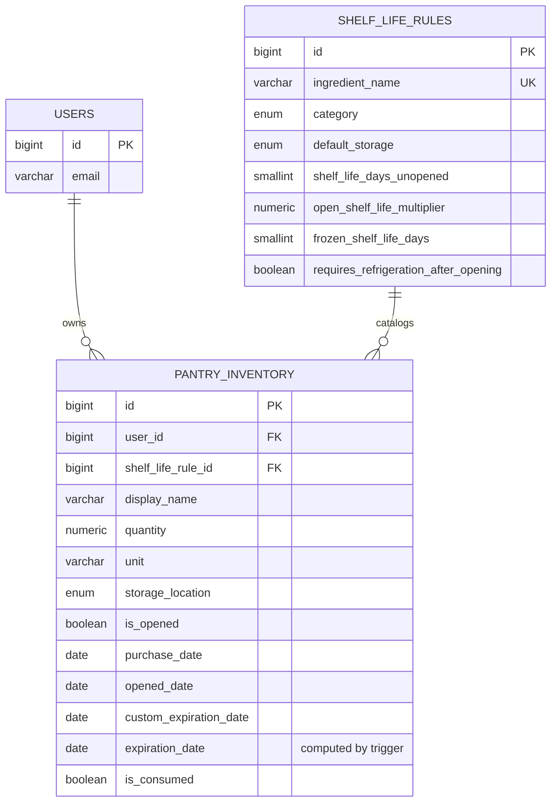

# Database schema — zero-waste kitchen inventory

## Entity relationship diagram



## Relationships

- **`pantry_inventory.user_id` → `users.id`** (`ON DELETE CASCADE`): deleting a user deletes their inventory.
- **`pantry_inventory.shelf_life_rule_id` → `shelf_life_rules.id`** (`ON DELETE SET NULL`): the catalog is the source of the expiry rule, but deleting a rule must not delete the user's stock. The item simply becomes uncatalogued and depends on `custom_expiration_date`.

This is a classic **catalog (1) — inventory (N)** relationship. `shelf_life_rules` is read-mostly, maintained by seed and administration; `pantry_inventory` is transactional and grows with every shop.

## Expiry logic (the `calculate_pantry_expiration` trigger)

Priority order when computing `expiration_date`:

1. `custom_expiration_date`, when the user set it manually (for example the date printed on the pack) — always wins.
2. In the `freezer`, when the rule defines `frozen_shelf_life_days` → `purchase_date + frozen_shelf_life_days`.
3. When `is_opened = TRUE` → `opened_date + ROUND(shelf_life_days_unopened * open_shelf_life_multiplier)`.
4. Otherwise → `purchase_date + shelf_life_days_unopened`.
5. With neither a rule nor a manual date, it cannot be computed: `NULL` on insert, previous value kept on update.

This recalculates automatically on every `INSERT` and `UPDATE` of `pantry_inventory` — for example when `is_opened` is set to `TRUE` — so the application never replicates this date logic. It only reads the result.

## Execution order

```bash
psql -d your_db -f database/schema.sql
psql -d your_db -f database/seed_shelf_life_rules.sql
```

> **Note on `users`:** the table in `schema.sql` is a minimal stub so the foreign keys are valid standalone. If your project already has authentication (Cognito, Supabase, Auth0, and so on), delete that block and change the type of `pantry_inventory.user_id` to match your real primary key, for example `UUID`.
