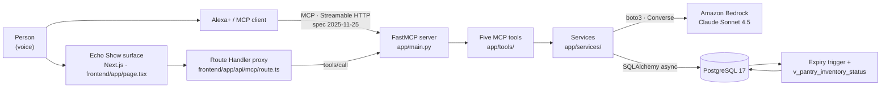

# Architecture

Module-level detail and the full MCP tool contracts. For setup and a product overview, see the [README](../README.md).

## In twenty seconds

Alexa+ connects to a self-hosted MCP server that speaks specification 2025-11-25 over Streamable HTTP. That server exposes five typed tools over one pantry held in PostgreSQL. Amazon Bedrock is called twice, for two different jobs: once to read a receipt photograph into structured line items, once to reason about what to cook from what is about to expire. Expiry itself is computed by a PostgreSQL trigger, never in application code, so the voice channel and the screen cannot disagree. The Next.js Echo Show surface is a second consumer of the same MCP server, not a layer on top of it.

## System



The browser never reaches PostgreSQL, AWS or the MCP endpoint directly. It asks the Route Handler, which negotiates a server-to-server MCP session.

## Receipt upload, end to end

```mermaid
sequenceDiagram
    actor User
    participant UI as Dev bench<br/>dev-bench.tsx
    participant API as Route Handler<br/>api/mcp/route.ts
    participant MCP as FastMCP<br/>app/main.py
    participant SVC as inventory.py
    participant BR as Amazon Bedrock
    participant PG as PostgreSQL

    User->>UI: choose receipt photo
    UI->>UI: FileReader → base64, strip data URL
    UI->>API: POST {tool, arguments}
    API->>API: check tool against allow-list
    API->>MCP: initialize → Mcp-Session-Id
    API->>MCP: tools/call ingest_receipt_items
    MCP->>SVC: decode, validate type and 5 MB limit
    SVC->>PG: SELECT shelf_life_rules (catalog)
    SVC->>BR: converse(image + catalog-constrained prompt)
    BR-->>SVC: JSON line items (fenced; fence stripped)
    SVC->>SVC: validate, extra="forbid"
    SVC->>PG: INSERT pantry_inventory
    PG->>PG: trigger computes expiration_date
    PG-->>SVC: rows with expiry assigned
    SVC-->>API: structuredContent
    API-->>UI: items + dates
    UI-->>User: transcript names the tool; cards appear
```

A failure is shown as a failure. No credentials produces a real error state, never a stubbed recipe or an invented date.

## Components

| Component | Responsibility | Path | Track / AWS tech |
|---|---|---|---|
| MCP server | Builds FastMCP, runs Streamable HTTP | `app/main.py` | **Alexa+ / MCP 2025-11-25** |
| Inventory tools | 4 of the 5 tool definitions | `app/tools/inventory.py` | MCP |
| Recipe tool | Generate and adapt | `app/tools/recipe.py` | MCP |
| Error boundary | Stops OS errors reaching clients | `app/tools/errors.py` | MCP |
| Bedrock plumbing | Converse client, fence strip, validation | `app/services/bedrock.py` | **Amazon Bedrock** |
| Receipt extraction | Photo to structured items | `app/services/inventory.py` | **Amazon Bedrock** |
| Recipe reasoning | Plan and re-plan around expiry | `app/services/recipe.py` | **Amazon Bedrock** |
| Spoken context | Voice overrides shelf life | `app/services/context.py` | MCP |
| Expiry engine | Owns every expiration date | `database/schema.sql` | PostgreSQL trigger |
| Echo Show surface | 1280x800 ambient screen | `frontend/app/page.tsx` | — |
| MCP proxy | Server-side, tool allow-list | `frontend/app/api/mcp/route.ts` | MCP |
| MCP client | Session negotiation, tools/call | `frontend/lib/mcp-client.ts` | MCP |

## Built during the hackathon window

All of it. First commit 2026-09-28; nothing pre-existing.

## Layers

```
Alexa+ / MCP client
        |  MCP, Streamable HTTP, spec 2025-11-25
        v
app/main.py            FastMCP server, tool registration
app/tools/             MCP tool definitions (thin; schema comes from type hints)
app/services/          business logic, Bedrock calls, SQLAlchemy work
app/models/            SQLAlchemy 2.0 ORM entities
app/schemas/           Pydantic v2 validation
database/schema.sql    ENUMs, tables, status view, expiry trigger
```

The Next.js frontend is a parallel consumer of the same MCP server, not a layer above it. It reaches the server through a server-side Route Handler so the browser never sees the MCP endpoint, the database or AWS.

## Backend modules

| Path | Responsibility |
|---|---|
| `app/main.py` | `build_server()` assembles the `FastMCP` instance from settings; the `mcp` singleton runs with `transport="streamable-http"` |
| `app/core/config.py` | Pydantic settings from the environment or `.env` |
| `app/tools/inventory.py` | Registers `get_inventory_status`, `modify_item_state`, `ingest_receipt_items`, `update_pantry_context` |
| `app/tools/recipe.py` | Registers `generate_and_adapt_recipe` |
| `app/tools/errors.py` | Sanitizing boundary: unexpected exceptions are logged, not sent to the client |
| `scripts/mcp_smoke.py` | Drives a running server with the official MCP SDK client; not part of the app |
| `app/services/inventory.py` | Inventory reads and writes, receipt parsing via Bedrock, catalog mapping |
| `app/services/context.py` | Spoken shelf-life overrides via `custom_expiration_date` |
| `app/services/recipe.py` | Recipe generation and adaptation over the live pantry |
| `app/services/bedrock.py` | Shared Converse client, fence stripping and JSON validation |
| `app/db/session.py` | Async engine and session factory |
| `app/models/` | `ShelfLifeRule`, `PantryInventory`, shared enums, timestamp mixin |
| `app/schemas/` | Create/update/read schemas for both tables |

## Frontend modules

| Path | Responsibility |
|---|---|
| `app/page.tsx` | Kitchen workspace: event simulator, summary, search, filters, inventory rows |
| `app/api/mcp/route.ts` | Server-side proxy with a tool allow-list |
| `lib/mcp-client.ts` | JSON-RPC Streamable HTTP client: initialize, initialized notification, `tools/call`, session teardown |
| `lib/kitchen-data.ts` | Types mirroring `v_pantry_inventory_status`, demo fixtures, date and label helpers |
| `components/status-pill.tsx` | Accessible status indicator; combines `status-pill` with `status-${status}` |
| `app/globals.css` | Visual tokens, traffic-light colours, responsive breakpoints |

## MCP transport

- Default URL: `http://127.0.0.1:8000/mcp`
- `POST /mcp` — initialize, notifications, `tools/list` and `tools/call` as JSON-RPC 2.0 messages. The client must accept both `application/json` and `text/event-stream`.
- `GET /mcp` — optional server event channel for a Streamable HTTP session.
- `DELETE /mcp` — ends the protocol session.

Negotiation creates a session; later requests must carry the `Mcp-Session-Id` header returned by `initialize`.

```json
{
  "jsonrpc": "2.0",
  "id": 1,
  "method": "initialize",
  "params": {
    "protocolVersion": "2025-11-25",
    "capabilities": {},
    "clientInfo": {"name": "my-client", "version": "1.0"}
  }
}
```

The client then sends `notifications/initialized`, queries `tools/list` and runs tools with `tools/call`. There are no per-tool REST routes.

**Host validation.** The MCP SDK enables DNS rebinding protection automatically when the server binds to `127.0.0.1`, `localhost` or `::1`, permitting only `127.0.0.1:*`, `localhost:*` and `[::1]:*` as Host headers. Anything else is rejected with HTTP 421. Tests must therefore use an allowed host, not a synthetic one.

## Verify it with a real MCP client in two minutes

The frontend talks to the server through its own JSON-RPC code in `lib/mcp-client.ts`, and the test suite drives the app in-process over ASGI. Neither proves that an independent MCP client can negotiate a session over a socket, so `scripts/mcp_smoke.py` does exactly that, using `mcp.client.streamable_http` and `ClientSession` from the official MCP Python SDK.

```powershell
docker compose up -d                 # terminal 1, optional but gives real rows
python -m app.main                   # terminal 2
python scripts/mcp_smoke.py          # terminal 3
```

It prints the negotiated `protocolVersion`, the `Mcp-Session-Id` the transport is carrying, every tool with its required arguments, and two `tools/call` results. It exits 0 when the session negotiated and both calls succeeded, 1 when a tool returned an error, and 2 when the server could not be reached.

Without the database it still exits 1 rather than crashing, and the inventory call reports `Inventory database unavailable - start it with: docker compose up -d`. That is the intended demonstration of the sanitizing boundary described under [Tool errors](#tool-errors), not a failure of the script.

### Connect a desktop MCP client

[`docs/mcp-client-config.json`](mcp-client-config.json) is the stanza to paste into an MCP-capable client's configuration file:

```json
{
  "mcpServers": {
    "eat-me-first": {
      "type": "streamable-http",
      "url": "http://127.0.0.1:8000/mcp"
    }
  }
}
```

Merge the inner entry into an existing `mcpServers` object rather than replacing the file. Two things commonly go wrong:

- **Keep the host as `127.0.0.1` or `localhost`.** The server binds to loopback, so the SDK enables DNS rebinding protection and answers any other Host header with HTTP 421. Reaching the server from another machine means changing the bind address, which disables that protection — see the security notes in the README first.
- **Older clients have no native Streamable HTTP transport.** They need a stdio bridge, typically `npx mcp-remote http://127.0.0.1:8000/mcp` as the command, because this server speaks HTTP and never stdio.

## Tool contracts

### `get_inventory_status`

```json
{"user_id": 17, "include_consumed": false}
```

`user_id` is required and an integer. `include_consumed` is optional, boolean, default `false`.

The response carries `user_id`, `count` and `items`. Each item has `id`, `display_name`, `ingredient_name`, `category`, `storage_location`, `quantity`, `unit`, `is_opened`, `expiration_date`, `days_remaining` and `status`. `quantity` is a decimal serialized as text; dates are ISO 8601. Statuses come from `v_pantry_inventory_status`: `fresh`, `expiring_soon`, `expired`, `consumed`, `unknown`.

### `modify_item_state`

```json
{
  "user_id": 17,
  "item_id": 42,
  "is_opened": true,
  "opened_date": "2026-10-07",
  "storage_location": "freezer",
  "is_consumed": false
}
```

`user_id` and `item_id` are required integers. The rest are optional: `is_opened` and `is_consumed` are booleans, `opened_date` is an ISO `YYYY-MM-DD` date, and `storage_location` accepts `pantry`, `refrigerator` or `freezer`. At least one state field must be supplied.

`opened_date` requires `is_opened: true`. Opening without a date uses today; closing clears `opened_date`. Marking consumed records `consumed_at`; reverting clears it.

Success returns `{"success": true, "item": ...}`. A missing item, or one belonging to another user, returns `{"success": false, "error": ...}`. The application never computes or writes expiry dates — the PostgreSQL trigger recalculates them.

### `ingest_receipt_items`

```json
{
  "user_id": 17,
  "image_base64": "...base64 without a data URL prefix...",
  "media_type": "image/jpeg"
}
```

`user_id` and `image_base64` are required. `media_type` is optional and defaults to `image/jpeg`; `image/jpeg`, `image/png`, `image/gif` and `image/webp` are accepted. Decoded content may not exceed 5 MB.

The tool matches `ingredient_name` against the names in `shelf_life_rules`. On a match it adopts the rule's default storage; otherwise it inserts the product as a free item in the pantry. PostgreSQL then computes `expiration_date` via its trigger.

The response carries `success`, `user_id`, `count` and `items`, where each item has `id`, `display_name`, `quantity`, `unit`, `shelf_life_rule_id`, `storage_location` and `expiration_date`. Extraction requires AWS credentials available to boto3 and permission to invoke the Bedrock model in `AWS_REGION`.

### `update_pantry_context`

```json
{"user_id": 17, "item_name": "Avocados", "modifier": "very_ripe"}
```

All three arguments are required. `modifier` is a closed set emitted as a JSON-Schema enum, so an invalid value is rejected by the protocol layer before any database work: `very_ripe` (1 day), `ripe` (3 days), `underripe` (extends by 3 days), `smells_off` (today, flagged for disposal) and `opened_long_ago` (1 day).

`item_name` is matched case-insensitively against both `display_name` and the catalog `ingredient_name`, newest purchase first, excluding consumed items. An exact display-name match wins outright. Otherwise an ambiguous match writes nothing and returns `success: false` with a `candidates` list, so a conversational client can ask a follow-up question rather than guess.

The write goes to `custom_expiration_date`, which the trigger honours above every other branch. The response reports both `previous_expiration_date` and the new `expiration_date` so the caller can narrate the change.

### `generate_and_adapt_recipe`

```json
{
  "user_id": 17,
  "servings": 2,
  "exclude_items": ["Cream"],
  "prior_recipe": "Carbonara"
}
```

Only `user_id` is required. `servings` defaults to 2 and must be 1-12.

With no `prior_recipe` the tool generates; with one it adapts, keeping the dish recognisable and changing only what the exclusions force. Items are filtered to statuses `fresh`, `expiring_soon` and `unknown` -- `expired` is deliberately excluded, because the product exists to prevent waste rather than to recommend eating spoiled food.

The response carries `recipe` (title, servings, total_minutes, uses_expiring, ingredients, steps, missing) plus `expiring_soon_in_pantry`, which is derived from the inventory rather than from the model's answer. A client can compare the two and say so when they diverge.

## Tool errors

Anything that escapes a tool body is wrapped by FastMCP into `Error executing tool <name>: <exception>` and sent to the client verbatim. Left alone, that is how a raw `[WinError 1225]` connection-refused string — in the system language of whatever machine the server runs on — became the first thing a reviewer saw when PostgreSQL was not running.

`app/tools/errors.py` provides `sanitize_tool_errors`, applied to all five tools:

| Raised in the tool body | What the client receives |
|---|---|
| `ValueError` | the message unchanged |
| `SQLAlchemyError`, `OSError` | `Inventory database unavailable - start it with: docker compose up -d` |
| anything else | the tool's own short fallback message |

`ValueError` passes through on purpose. Every one in this codebase is hand-written English validation text that a conversational client should read back to the user, and the tests assert on those strings. Everything else is logged with `logger.exception` under `app.tools.errors`, so the operator keeps the traceback while the client gets an instruction.

## Bedrock integration notes

Three behaviours of the Converse API shaped this code and are worth knowing before changing it.

1. **There is no structured-output mode.** JSON is requested in prose and parsed on return, then validated by a Pydantic model with `extra="forbid"`.
2. **The model fences JSON in backticks** even when told to return bare JSON, so `_extract_receipt_items_from_bedrock` strips the fence before parsing.
3. **Image input wants a format enum, not a media type.** Converse expects `"jpeg"`, not `"image/jpeg"`, so `IMAGE_FORMATS` translates between them.

`boto3` has no async client, so the Bedrock call is offloaded with `asyncio.to_thread` to avoid blocking the event loop and stalling other MCP sessions.

## Testing

```powershell
python -m pytest -q
```

`tests/test_mcp_streamable_http.py` negotiates the protocol over ASGI, verifies the session, lists tool schemas and calls all three tools with the database layer faked. Receipt service tests replace Bedrock with a fake client, so no AWS credentials are needed.

Running a FastMCP server in-process requires both `mcp.streamable_http_app()` **and** separately entering `async with mcp.session_manager.run()`. Without the second, every request fails. This is not documented in the SDK.

A second, related trap: `session_manager.run()` may be entered only once per `FastMCP` instance. Two tests sharing the module-level `mcp` singleton would leave whichever ran second failing with "run() can only be called once per instance" — a failure that looks like a protocol bug and is really test-ordering. `app.main.build_server()` exists so every test gets its own server.

PostgreSQL trigger tests skip unless `TEST_DATABASE_URL` is set. They are the only tests that exercise the expiry calculation, so a default `pytest -q` run does not cover it. `docker compose up -d` plus that one variable is enough to include them; CI sets both against a service container so the trigger is covered on every push.

They connect with the synchronous `postgresql+psycopg://` driver while the application uses `postgresql+asyncpg://`. `psycopg` therefore lives in `requirements-dev.txt`, not `requirements.txt` — the runtime file stays free of test-only packages.

Frontend tests use Vitest, JSDOM and React Testing Library. `tests/status-pill.test.tsx` checks the five status classes and the transition from `fresh` to `expired`.

## Traffic-light classes

| Backend status | React/CSS class | Colour |
|---|---|---|
| `fresh` | `status-fresh` | Green |
| `expiring_soon` | `status-expiring_soon` | Amber |
| `expired` | `status-expired` | Coral |
| `consumed` | `status-consumed` | Grey-green |
| `unknown` | `status-unknown` | Blue-grey |

The class derives directly from `status`. A `null` `expiration_date` is never turned into an invented date; the view returns `unknown`.

## Known limits

The server does not authenticate clients. `user_id` arrives in the payload and scopes the query, but proves nothing about the caller's identity.

Generic item intake from free text is not implemented; `ingest_receipt_items` only covers receipt photos.

The frontend uses `user_id: 1` as a demo user. Configure `MCP_URL` in the Next server environment, never as a public `NEXT_PUBLIC_*` variable.
